<div align="center">

# CodeAtlas Compile

**Sieh live zu, wie die KI deinen Code baut.**

Ein Arbeitsplatz zum Vibecoding mit [Claude Code](https://code.claude.com/docs): Du schreibst links, was entstehen soll – rechts wächst dein Projekt als lebendes Diagramm. Jede Datei, die die KI liest, jede Funktion, die sie ändert, jede neue Verbindung leuchtet in dem Moment auf, in dem sie passiert.


[Schnellstart](#schnellstart) · [Funktionen](#was-du-damit-machen-kannst) · [Bedienung](#bedienung) · [Dokumentation](docs/DOKUMENTATION.md)

</div>

> **English summary:** CodeAtlas Compile is a local workbench for vibe coding with Claude Code. A small Python bridge (standard library only) runs Claude Code in your project folder and streams every step to a browser UI that renders your code as a live class/module diagram — you see what the AI reads, edits, runs and connects, approve shell commands, compare and roll back every change, run programs with live call tracing, and let Claude query the code graph via MCP. The UI is in German.

---

## Warum?

Beim Vibecoding siehst du normalerweise nur einen Chat und am Ende einen Haufen geänderter Dateien. Was hat die KI gelesen? Welche Stellen hängen an der Funktion, die sie gerade umbaut? Ist das Programm danach noch dasselbe?

CodeAtlas Compile macht die Arbeit der KI **sichtbar und kontrollierbar** – wie ein Compiler, der dir beim Bauen über die Schulter schauen lässt:

- **Sehen**, was passiert: Lesen, Ändern, Ausführen – live im Diagramm.
- **Entscheiden**, was passieren darf: Befehle laufen nur nach deiner Freigabe.
- **Prüfen**, was herausgekommen ist: Änderungen auf Ebene von Funktionen und Verbindungen, Tests, Live-Trace.
- **Zurück**, wenn es schiefging: Vor jedem Auftrag ein Kontrollpunkt.

---

## Was du damit machen kannst

### Live zusehen – in der einfachen Ansicht

Der Atlas startet aufgeräumt: links der Chat, rechts dein Code als Diagramm mit allen Funktionen. Die Kamera folgt der KI von Baustein zu Baustein; was sie liest, leuchtet blau, was sie ändert, orange, neue Bausteine grün. Greift sie kurz auf eine weit entfernte Stelle zu, zeigt ein kleines Bild-im-Bild-Fenster, was dort passiert.

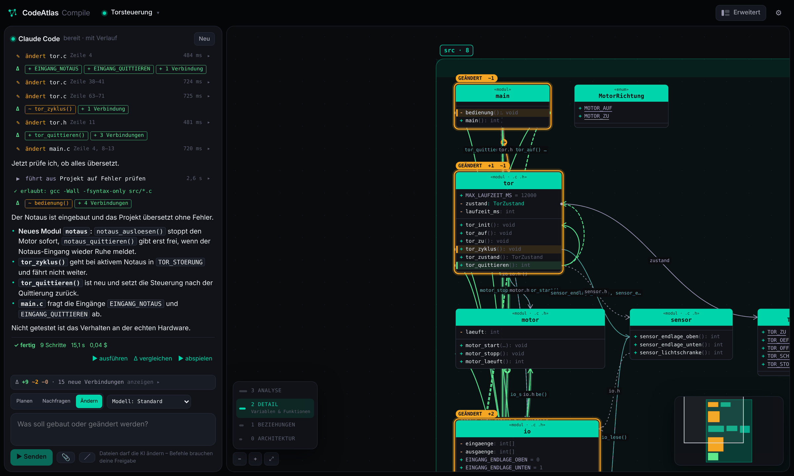

### Freigaben mit Durchblick

Will Claude Code einen Befehl ausführen, fragt der Atlas nach – mit Befehl, Zweck und Zeitlimit. **Erlauben**, **Immer** (für diesen Befehl) oder **Ablehnen**. Dateiänderungen darfst du je nach Arbeitsweise (*Planen*, *Nachfragen*, *Ändern*) freigeben oder automatisch zulassen.

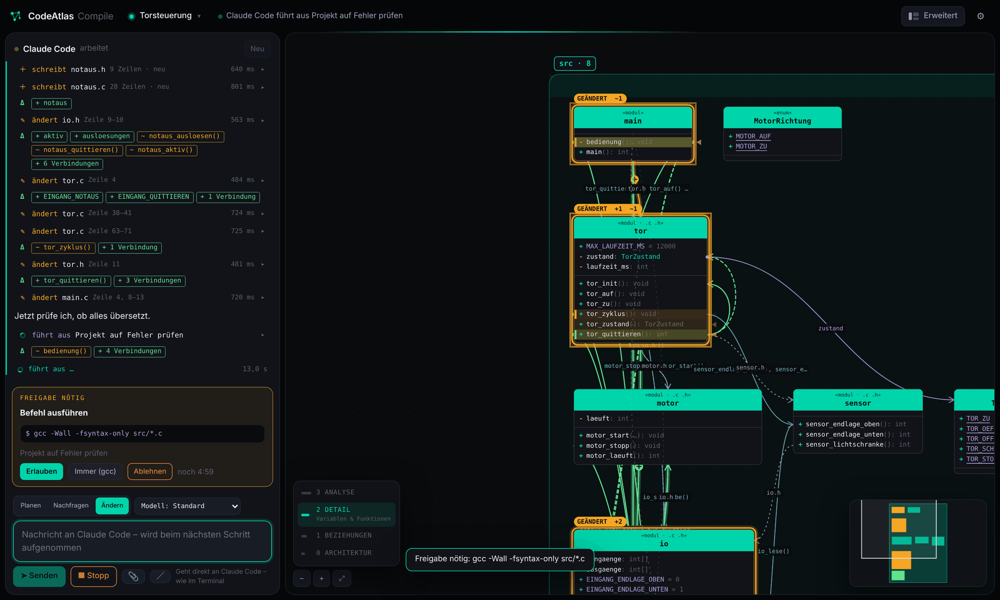

### Änderungen verstehen und zurücksetzen

Nach jedem Auftrag zeigt der Atlas nicht nur Dateien, sondern **welche Bausteine, Funktionen und Verbindungen** neu, geändert oder entfernt sind – im Diagramm markiert und als Liste mit Diff. Jeder Auftrag beginnt mit einem Kontrollpunkt: einzelne Dateien oder alles zurücksetzen, und auch das Zurücksetzen lässt sich wieder aufheben.

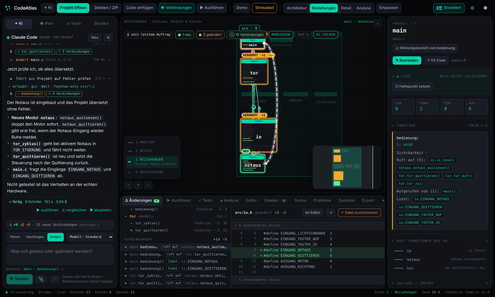

### Ausführen mit Live-Trace

**▶ ausführen** startet das Programm (C/C++ und Python). Während es läuft, zählt das Diagramm die Aufrufe jeder Funktion, zeigt Argumente, Ergebnisse, Laufzeiten und Fehlerorte. Mit Haltepunkten, Einzelschritt und Zeitlupe wird daraus ein visueller Debugger.

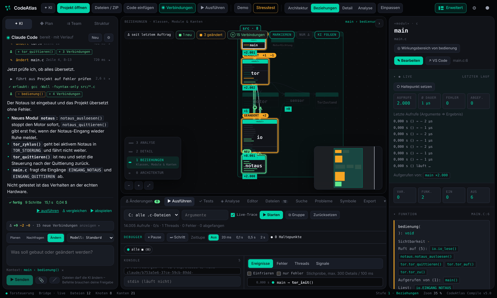

### Tests im Atlas – auch für die KI

Tests laufen direkt im Atlas (pytest, unittest, C mit mitgeliefertem Mini-Framework). Fehlgeschlagene Tests zeigen den genauen Ort im Diagramm, die Abdeckung zeigt, welche Funktionen nie ausgeführt wurden. Claude Code kann über das Werkzeug `tests_run` selbst Tests schreiben, im Atlas laufen lassen und aus dem Ergebnis lernen – verlässlicher als Konsolenausgabe.


### Claude fragt den Graphen

Der Atlas stellt Claude Code sein Wissen über dein Projekt als MCP-Werkzeuge zur Verfügung: `atlas_orient` (Überblick), `atlas_find`, `atlas_read` (genau eine Funktion samt Aufrufern), `atlas_trace` (Aufrufpfad A → B), `atlas_impact` (wer hängt davon ab, welche Tests sind betroffen) und `atlas_rules`. Statt ganze Dateien zu lesen, fragt Claude gezielt – das spart Zeit und Kosten.

### Wirkungsbereich

Ein Klick auf **◎ Wirkungsbereich** zeigt, welche Stellen von einer Funktion abhängen und welche Tests es trifft. Dieselbe Angabe steht in jeder Freigabe. Nach einem Auftrag laufen nur die Tests, die den geänderten Code wirklich ausführen.

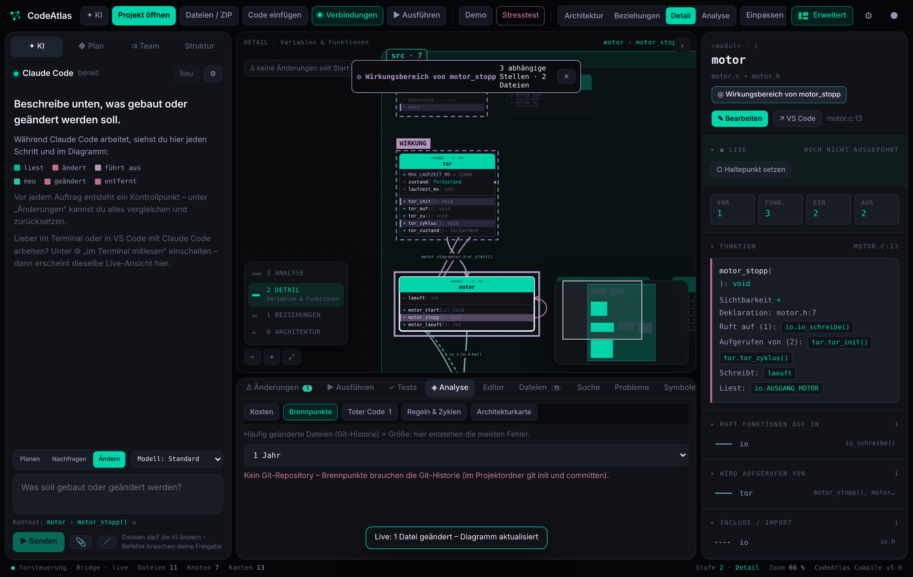

### Pipeline: Idee → Spezifikation → Plan → Aufgaben → Umsetzen

Für größere Vorhaben: Du beschreibst die Idee, Claude schreibt nacheinander Spezifikation, Plan und Aufgaben (mit Dateien, Abhängigkeiten und Prüfung). Jede Stufe gibst du frei oder überarbeitest sie, dann arbeitet Claude die Aufgaben einzeln oder alle nacheinander ab.

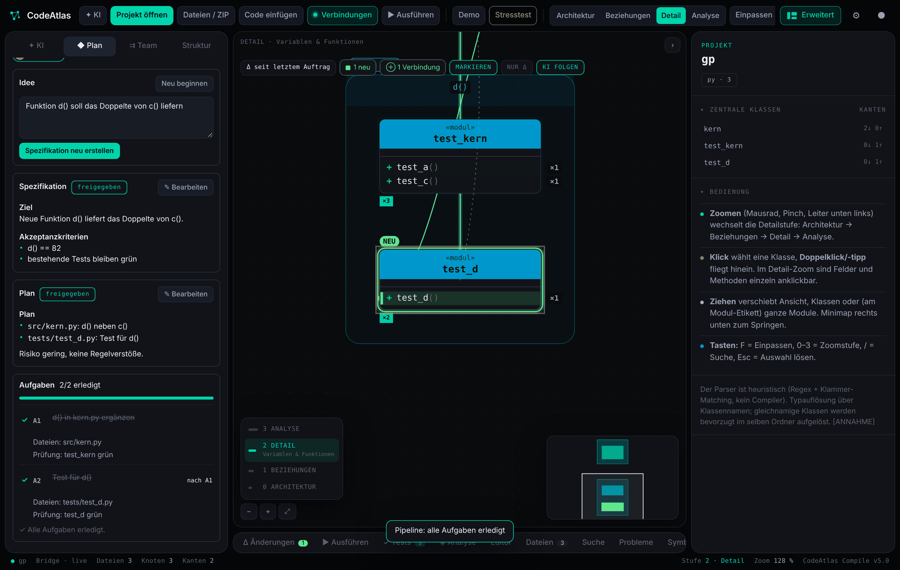

### Qualitätstor

Bevor Claude „fertig“ melden darf, prüft der Atlas Tests, Build und Architekturregeln. Scheitert etwas, bekommt Claude den Bericht und bessert nach – höchstens drei Runden.

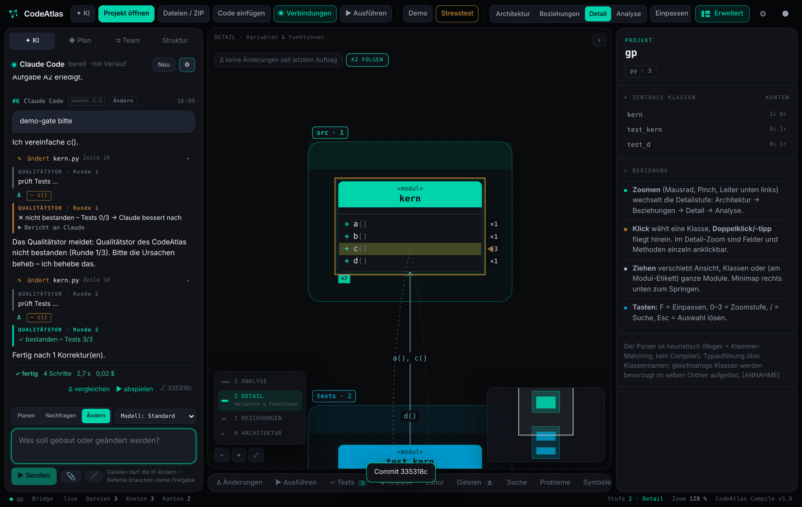

### Team: mehrere Agenten parallel

Weitere Claude-Agenten arbeiten gleichzeitig, jeder in einem eigenen Git-Worktree und in eigener Farbe im Diagramm. Der Atlas zeigt Konflikte zwischen den Agenten, den Diff jedes Agenten und führt per Klick zusammen – bei Konflikten wird abgebrochen, das Hauptprojekt bleibt unverändert.

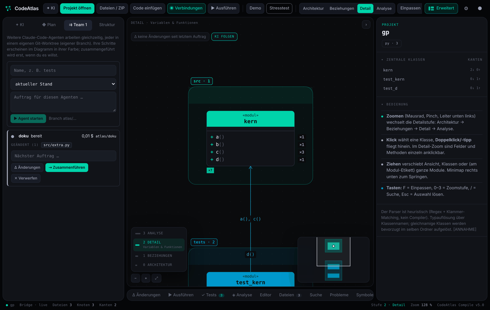

### Analyse und Architekturregeln

- **Architekturregeln** wie „`gui` darf nicht auf `db` zugreifen“ – Verstöße und Abhängigkeitszyklen erscheinen unter *Probleme*.
- **Kosten** pro Auftrag und pro Datei, auch als Wärmekarte im Diagramm.
- **Brennpunkte** aus der Git-Historie und **toter Code**.
- **Architekturkarte**, die der Atlas auf Wunsch in deine `CLAUDE.md` schreibt und aktuell hält.
- **Commit pro Auftrag** – jeder Auftrag einzeln mit `git revert` rückgängig zu machen.
- **▶ abspielen** – einen Auftrag Schritt für Schritt noch einmal über das Diagramm laufen lassen.

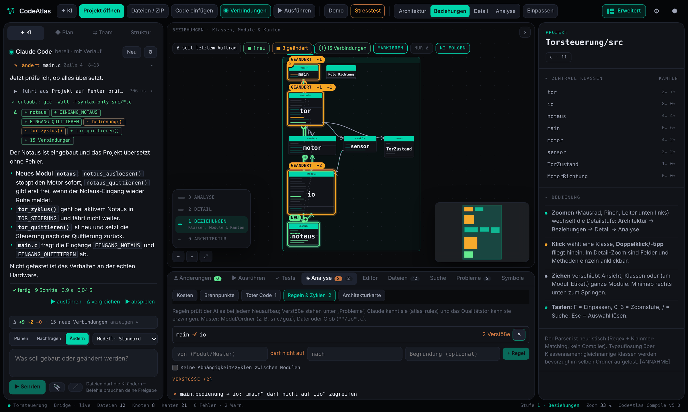

### Einstellungen, hell und dunkel

Alles Weitere – Struktur, Details, Konsole, Plan, Team, Verbindungen – blendet **Erweitert** oben rechts ein. In den Einstellungen (⚙ oder `Strg+,`) wählst du Farbschema, Akzentfarbe, Chat-Breite, KI-Verhalten und Automatik.

<p align="center">
  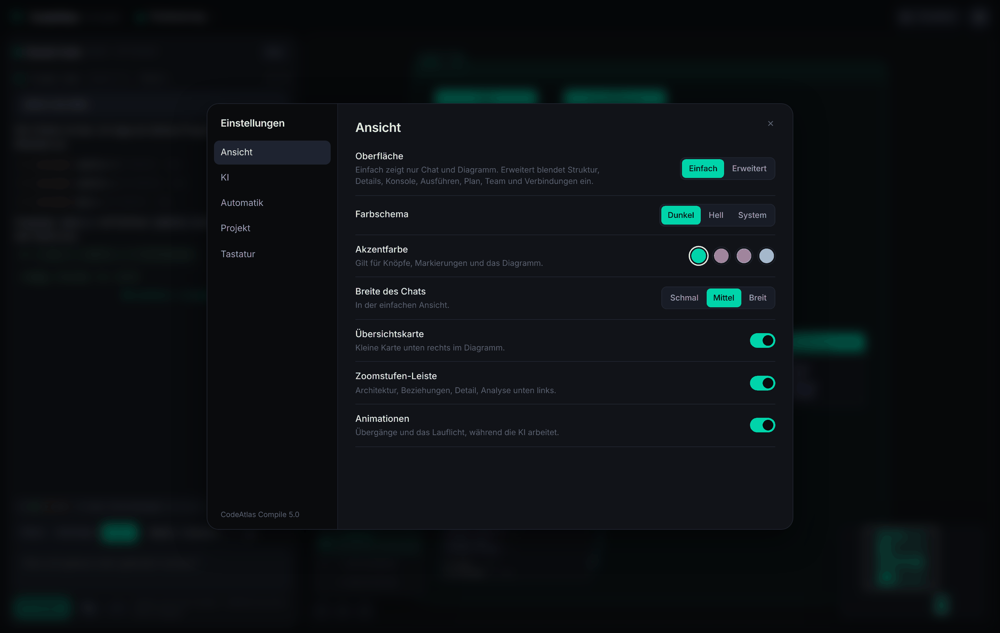
  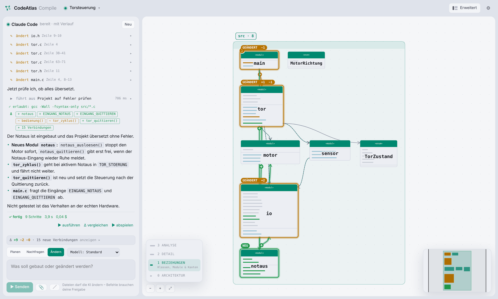
</p>

---

## Schnellstart

### Voraussetzungen

| | Wofür | Pflicht? |
|---|---|---|
| **Python 3.8+** | die Bridge (nur Standardbibliothek, keine Pakete) | ja |
| **[Claude Code](https://code.claude.com/docs)** | die KI; einmal im Terminal mit `claude` anmelden | für Vibecoding |
| **Chrome oder Edge** | eigenes App-Fenster (sonst jeder moderne Browser) | empfohlen |
| **Git** | Team, Brennpunkte, Commit pro Auftrag | optional |
| **gcc / Python** | Build-Prüfung, Ausführen, Live-Trace | optional |

### Installieren

```bash
git clone https://github.com/<dein-name>/CodeAtlasCompile.git
cd CodeAtlasCompile
```

Mehr ist nicht nötig: `CodeAtlas.html` ist fertig gebaut und liegt neben der Bridge.

### Starten

**Windows** – den Projektordner auf `CodeAtlas-starten.bat` ziehen (oder doppelklicken und den Pfad eingeben).

**Alle Systeme:**

```bash
python codeatlas_bridge.py "/pfad/zu/deinem/projekt" --desktop
```

`--desktop` öffnet den Atlas als eigenes Fenster in Chrome/Edge. Ohne die Option zeigt das Terminal die Adresse samt Zugangstoken; `--open` öffnet den Standardbrowser.

### Ausprobieren

Im Repository liegt ein kleines C-Beispiel (eine Torsteuerung):

```bash
python codeatlas_bridge.py examples/torsteuerung --desktop
```

Schreib dann zum Beispiel: *„Baue einen Notaus ein, der den Motor sofort stoppt und quittiert werden muss.“*

Ein leerer Ordner geht auch – Claude legt die Dateien an, und das Diagramm füllt sich live.

### Nur ansehen, ohne Bridge

`CodeAtlas.html` direkt im Browser öffnen und einen Ordner, Dateien oder ein ZIP hineinziehen – oder über ⚙ → *Projekt* die **Demo** laden. Ohne Bridge gibt es das Diagramm, die Suche und den Editor, aber keine KI, kein Ausführen und keine Tests.

---

## Bedienung

1. **Arbeitsweise wählen:** *Planen* (Claude plant nur), *Nachfragen* (jede Dateiänderung und jeder Befehl braucht deine Freigabe) oder *Ändern* (Dateien darf Claude ändern, Befehle brauchen deine Freigabe).
2. **Auftrag schreiben** und **Enter**. Markierst du vorher etwas im Diagramm, geht es als Kontext mit.
3. **Zusehen:** links jeder Schritt, rechts das Diagramm. Während der Arbeit kannst du weitere Nachrichten schicken – sie werden beim nächsten Schritt aufgenommen.
4. **Freigeben**, wenn Claude einen Befehl ausführen will.
5. **Prüfen:** unter dem Auftrag **Δ vergleichen**, **▶ ausführen** oder **▶ abspielen**.

### Tastenkürzel

| Taste | Wirkung |
|---|---|
| `I` | Auftrag an die KI schreiben |
| `F` | Diagramm einpassen |
| `0` – `3` | Zoomstufe: Architektur, Beziehungen, Detail, Analyse |
| `+` / `−` | Zoomen |
| `E` / `Umschalt+E` | Auswahl in der IDE / im eingebauten Editor öffnen |
| `K` | Konsole ein/aus |
| `B` | Build starten |
| `Esc` | Auswahl lösen |
| `Strg+O` | Projekt öffnen |
| `Strg+,` | Einstellungen |

### Nützliche Startoptionen

| Option | Wirkung |
|---|---|
| `--desktop` / `--open` | als App-Fenster / im Standardbrowser öffnen |
| `--port 7878` | Port (Standard 7878) |
| `--editor vscode` | Standard-Editor für „in der IDE öffnen“ (`cursor`, `codeblocks`, `pycharm`, …) |
| `--model sonnet` | Standardmodell für Claude Code |
| `--build "Make=make"` | eigenes Build-Preset |
| `--run "Server=npm start"` | eigene Start-Konfiguration |
| `--test "Jest=npx jest"` | eigener Testbefehl |
| `--no-mcp` | Claude keine Atlas-Werkzeuge geben |
| `--listen` / `--allow` | Zugriff aus einem VPN o. Ä. erlauben |

Alle Optionen: `python codeatlas_bridge.py --help` und [Kapitel 14 der Dokumentation](docs/DOKUMENTATION.md#14-startparameter-der-bridge).

---

## Wie es funktioniert

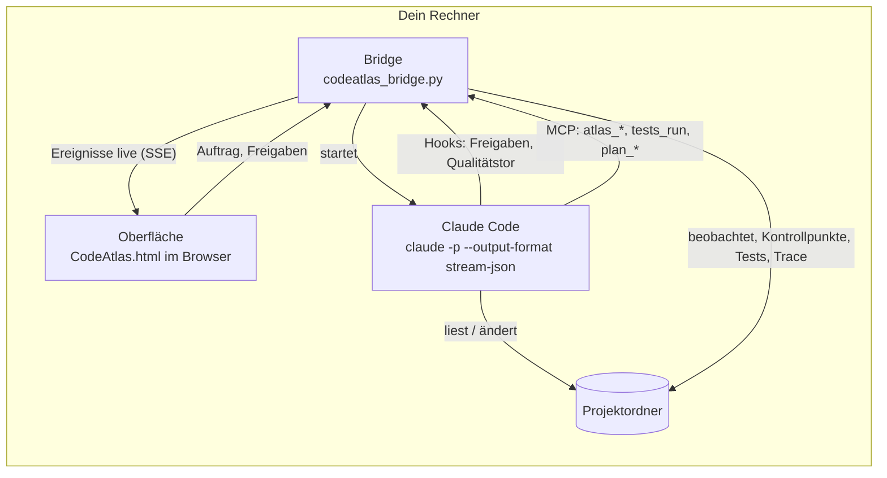

- **Bridge** (Python, eine Datei, nur Standardbibliothek): startet Claude Code im Projektordner, liest dessen Ereignisstrom, beobachtet Dateien, legt Kontrollpunkte an, führt Builds, Programme und Tests aus und liefert die Oberfläche aus.
- **Oberfläche** (React, eine Datei): analysiert den Code im Browser, zeichnet das Diagramm auf Canvas und verbindet sich über einen Ereignisstrom mit der Bridge.
- **Claude Code** läuft unverändert – mit deinem Konto, deinen Einstellungen, deinem Modell. Der Atlas klinkt sich über offizielle Wege ein: `stream-json`-Ausgabe, Hooks und einen MCP-Server.

Arbeitest du lieber im Terminal oder in VS Code mit Claude Code? Unter ⚙ → *KI* → **Claude Code im Terminal mitlesen** einschalten – dann erscheint dieselbe Live-Ansicht im Atlas.

## Sicherheit

- Die Bridge lauscht nur auf `127.0.0.1` und verlangt bei jeder Anfrage ein Token.
- Der Browser kann keine beliebigen Befehle starten – nur die beim Start festgelegten Presets.
- Shell-Befehle der KI laufen nur nach deiner Freigabe; ohne Antwort wird nach 5 Minuten abgelehnt.
- Vor jedem Auftrag entsteht ein Kontrollpunkt.
- Code, den die KI schreibt, läuft beim Ausführen und Testen mit deinen Rechten – schau ihn dir an, bevor du ein unbekanntes Programm startest.

## Unterstützte Sprachen

**Diagramm:** C, C++, Python, Java, C#, JavaScript, TypeScript, Go, Rust, Kotlin, Swift, PHP, Dart, Strukturierter Text (IEC 61131-3), SQL und vereinfacht viele weitere.
**Ausführen mit Live-Trace und Tests:** C/C++ und Python. Build-Prüfung zusätzlich für TypeScript, C#, Go und Rust.

## Oberfläche selbst bauen

`CodeAtlas.html` ist ein Bündel aus `src/CodeAtlasLab.jsx` und React. Nach Änderungen an der JSX:

```bash
cd build
npm install
npm run build     # schreibt ../CodeAtlas.html
npm run dev       # Entwicklungsfassung mit lesbaren Fehlermeldungen
```

## Projektstruktur

```
CodeAtlasCompile/
├── codeatlas_bridge.py      Bridge: Claude Code, Dateien, Build, Ausführen, Tests, MCP
├── CodeAtlas.html           fertig gebaute Oberfläche (wird von der Bridge ausgeliefert)
├── CodeAtlas-starten.bat    Starter für Windows
├── src/CodeAtlasLab.jsx     Quelltext der Oberfläche
├── build/                   esbuild-Skript zum Bündeln
├── examples/torsteuerung/   kleines C-Beispielprojekt
└── docs/
    ├── DOKUMENTATION.md     ausführliche Dokumentation (Bedienung, Speicherorte, HTTP-Schnittstelle)
    └── images/              Bilder für dieses README
```

Der Atlas legt in deinem Projekt einen Ordner `.codeatlas/` an (Verlauf, Kontrollpunkte, Pipeline, Regeln, Testzuordnung). Er gehört in die `.gitignore` deines Projekts.

## Stand und Grenzen

- Entwickelt und getestet unter Linux. Windows (der Hauptzielrechner) und macOS sind vorgesehen, aber noch nicht durchgetestet.
- Die automatischen Tests nutzen eine nachgestellte Claude-Code-CLI, die dieselben Ereignisse, Hooks und MCP-Aufrufe erzeugt wie das Original. Wie oft das echte Modell die Atlas-Werkzeuge von sich aus nutzt, hängt vom Modell und Auftrag ab.
- Die Code-Analyse ist heuristisch (kein vollständiger Compiler-Parser) – bei ungewöhnlichem Code kann eine Verbindung fehlen oder zu viel erscheinen.
- Die Oberfläche ist auf Deutsch.

Mehr dazu, zu allen Funktionen, Speicherorten und der HTTP-Schnittstelle der Bridge: **[docs/DOKUMENTATION.md](docs/DOKUMENTATION.md)**.

## Lizenz

[MIT](LICENSE)
