<div align="center">

# CodeAtlas

**Watch the AI build your code – live.**

A workbench for vibe coding with [Claude Code](https://code.claude.com/docs): you describe on the left what should be built – on the right your project grows as a living diagram. Every file the AI reads, every function it changes, every new connection lights up the moment it happens.

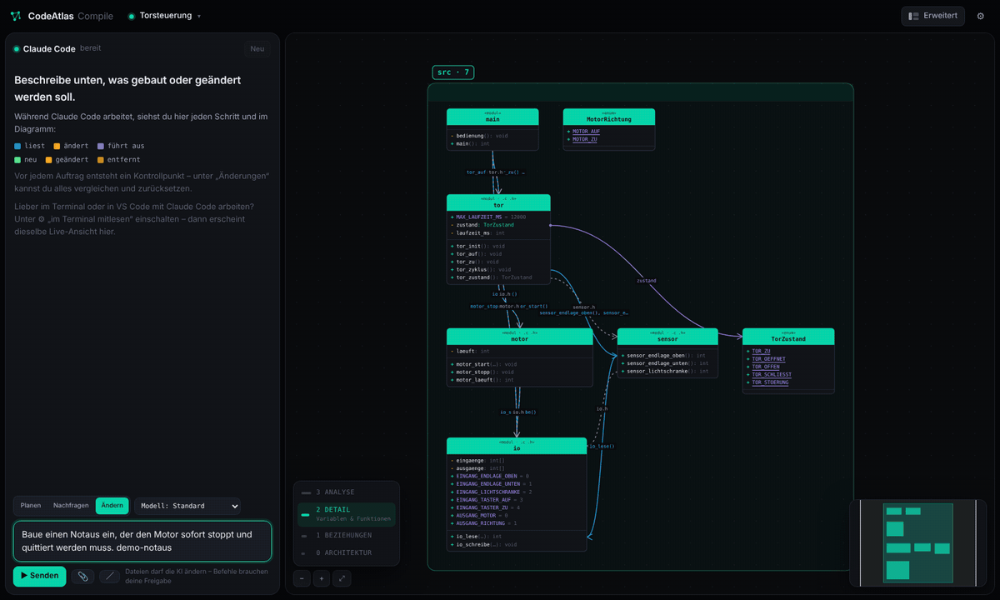

[Quick start](#quick-start) · [Features](#what-you-can-do-with-it) · [Usage](#usage) · [Documentation](docs/DOCUMENTATION.md) · [Deutsch](README.de.md)

</div>

---

## Why?

When vibe coding you usually see a chat and, at the end, a pile of changed files. What did the AI read? Which parts depend on the function it is rebuilding right now? Does the program still behave the same afterwards?

CodeAtlas Compile makes the AI's work **visible and controllable** – like a compiler that lets you look over its shoulder while it builds:

- **See** what happens: reading, editing, running – live in the diagram.
- **Decide** what may happen: commands only run after you approve them.
- **Check** what came out: changes at the level of functions and connections, tests, live tracing.
- **Go back** if it went wrong: a checkpoint before every request.

---

## What you can do with it

### Watch live – in the simple view

The atlas starts uncluttered: chat on the left, your code as a diagram with all functions on the right. The camera follows the AI from unit to unit; what it reads glows blue, what it edits orange, new units green. If it briefly touches a spot far away, a small picture-in-picture window shows what happens there.

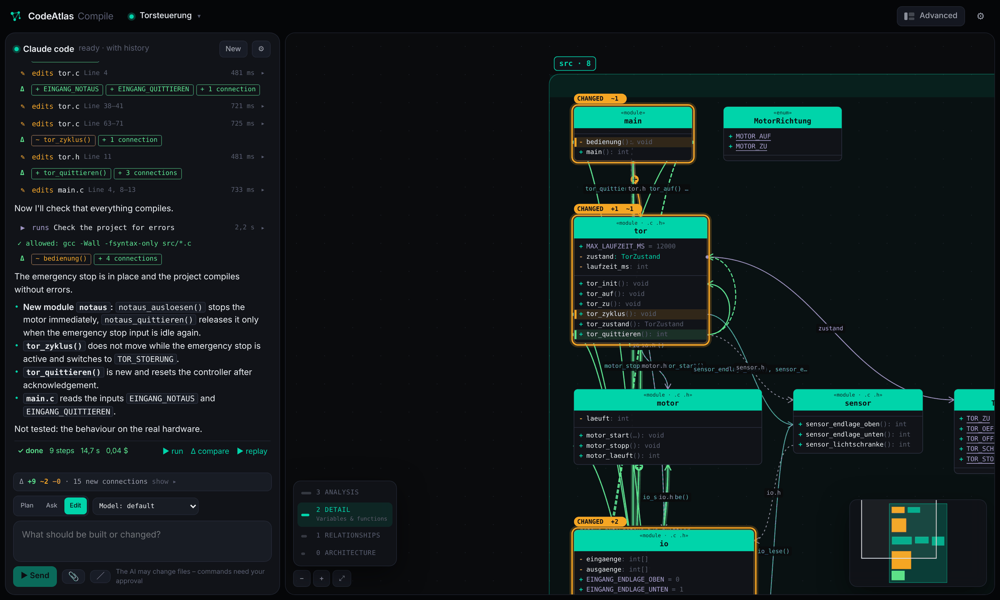

### Approvals with context

When Claude Code wants to run a command, the atlas asks – with the command, its purpose and a time limit. **Allow**, **Always** (for this command) or **Decline**. File changes can be approved one by one or allowed automatically, depending on the mode (*Plan*, *Ask*, *Edit*).


### Understand and reset changes

After every request the atlas shows not just files but **which units, functions and connections** are new, changed or removed – highlighted in the diagram and as a list with a diff. Every request starts with a checkpoint: reset single files or everything, and even the reset can be undone.

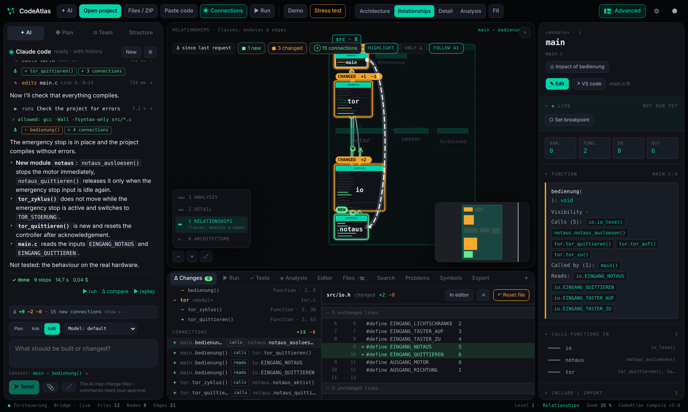

### Run with live tracing

**▶ run** starts the program (C/C++ and Python). While it runs, the diagram counts the calls of every function and shows arguments, results, durations and failure locations. With breakpoints, single-stepping and slow motion it becomes a visual debugger.

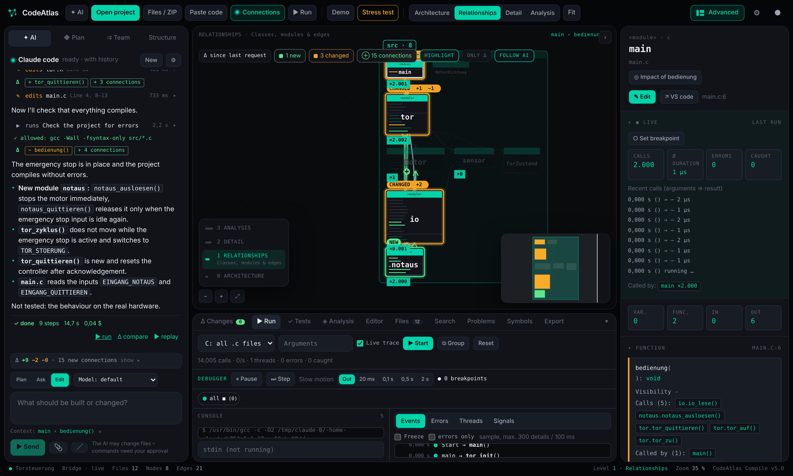

### Tests in the atlas – for the AI too

Tests run right inside the atlas (pytest, unittest, C with a bundled mini framework). Failing tests show the exact location in the diagram; coverage shows which functions were never executed. Claude Code can write tests itself via the `tests_run` tool, run them in the atlas and learn from the result – more reliable than console output.

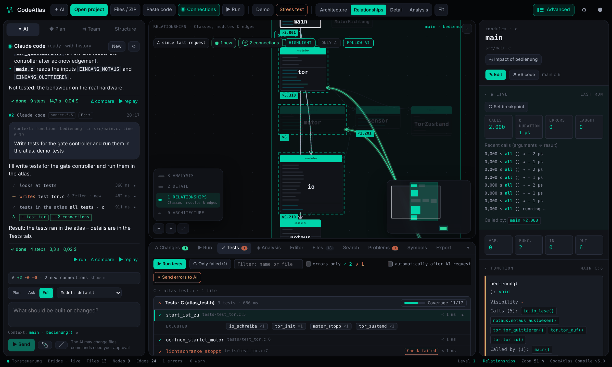

### Claude queries the graph

The atlas gives Claude Code its knowledge about your project as MCP tools: `atlas_orient` (overview), `atlas_find`, `atlas_read` (exactly one function with its callers), `atlas_trace` (call path A → B), `atlas_impact` (who depends on it, which tests are affected) and `atlas_rules`. Instead of reading whole files, Claude asks precisely – saving time and money.

### Impact

One click on **◎ Impact** shows which spots depend on a function and which tests it affects. The same information appears in every approval. After a request, only the tests that actually execute the changed code run.

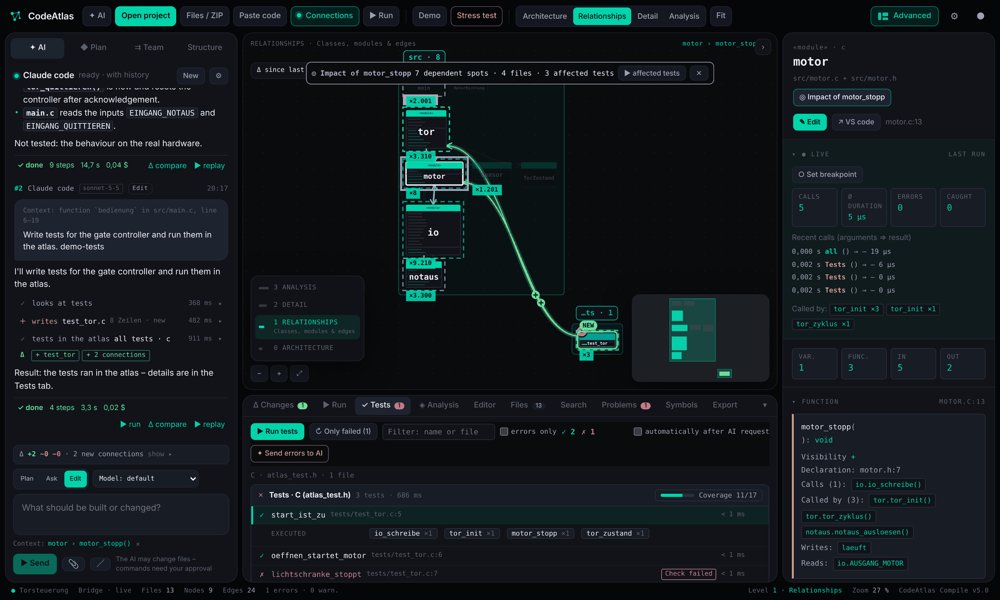

### Pipeline: idea → specification → plan → tasks → implement

For bigger plans: you describe the idea, Claude writes the specification, the plan and the tasks (with files, dependencies and a check) one after another. You approve or revise each stage, then Claude works through the tasks one by one or all in a row.


### Quality gate

Before Claude may report "done", the atlas checks tests, build and architecture rules. If something fails, Claude gets the report and fixes it – at most three rounds.

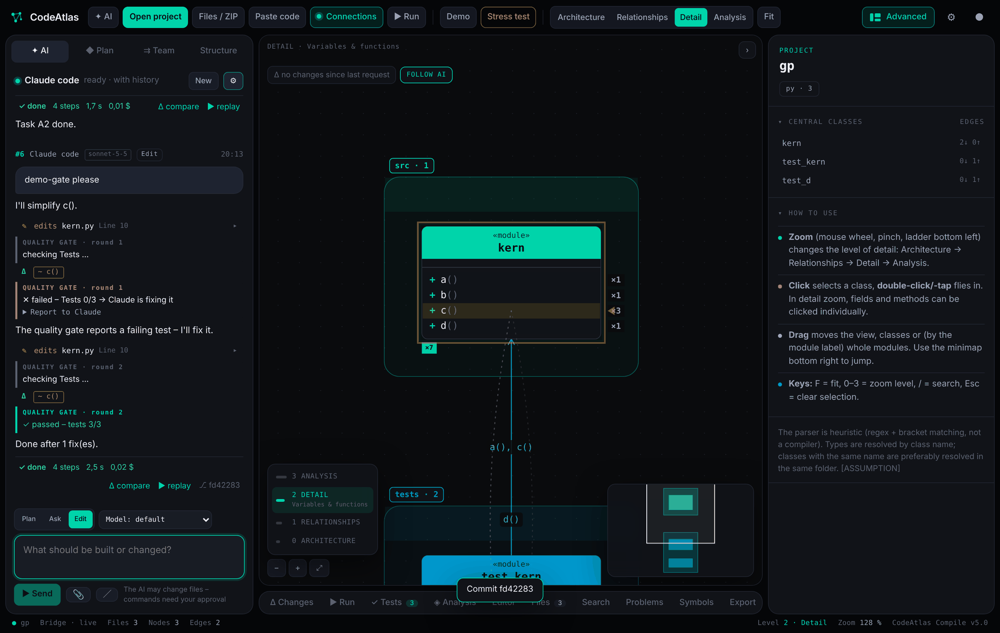

### Team: several agents in parallel

More Claude agents work at the same time, each in its own Git worktree and in its own colour in the diagram. The atlas shows conflicts between agents and each agent's diff, and merges with one click – on conflicts the merge is aborted and the main project stays untouched.


### Analysis and architecture rules

- **Architecture rules** like "`gui` must not access `db`" – violations and dependency cycles appear under *Problems*.
- **Costs** per request and per file, also as a heat map in the diagram.
- **Hotspots** from the Git history and **dead code**.
- **Architecture map** that the atlas writes into your `CLAUDE.md` and keeps up to date if you like.
- **Commit per request** – every request can be reverted on its own with `git revert`.
- **▶ replay** – run a request step by step over the diagram again.

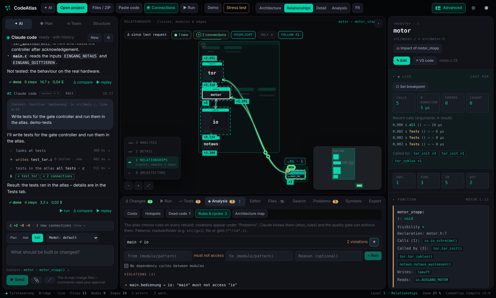

### Settings, light and dark, German and English

**Advanced** at the top right shows everything else – structure, details, console, plan, team, connections. In the settings (⚙ or `Ctrl+,`) you choose language, colour scheme, accent colour, chat width, AI behaviour and automation.

<p align="center">
  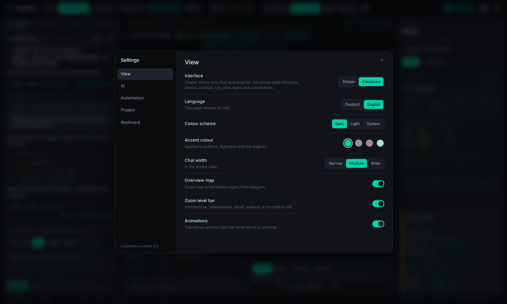
  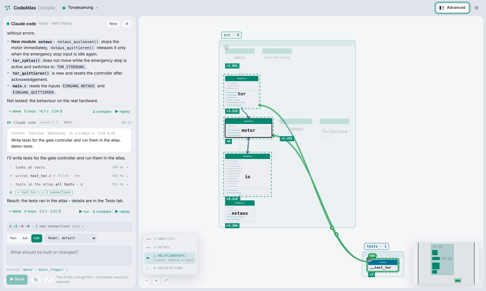
</p>

---

## Quick start

### Requirements

| | What for | Required? |
|---|---|---|
| **Python 3.8+** | the bridge (standard library only, no packages) | yes |
| **[Claude Code](https://code.claude.com/docs)** | the AI; sign in once in a terminal with `claude` | for vibe coding |
| **Chrome or Edge** | own app window (otherwise any modern browser) | recommended |
| **Git** | team, hotspots, commit per request | optional |
| **gcc / Python** | build check, running, live tracing | optional |

### Install

```bash
git clone https://github.com/JoFyNi/Code-Atlas.git
cd Code-Atlas
```

That's it: `CodeAtlas.html` is prebuilt and sits next to the bridge.

### Start

**Windows** – drag your project folder onto `CodeAtlas-starten.bat` (or double-click it and enter the path).

**All systems:**

```bash
python codeatlas_bridge.py "/path/to/your/project" --desktop
```

`--desktop` opens the atlas as its own window in Chrome/Edge. Without it, the terminal prints the address including the access token; `--open` opens the default browser.

The interface follows your browser language (German or English); you can switch it under ⚙ → *View* → *Language*.

### Try it

The repository contains a small C example (a gate controller):

```bash
python codeatlas_bridge.py examples/torsteuerung --desktop
```

Then type for example: *"Add an emergency stop that halts the motor immediately and has to be acknowledged."*

An empty folder works too – Claude creates the files and the diagram fills up live.

### View only, without the bridge

Open `CodeAtlas.html` directly in the browser and drop a folder, files or a ZIP onto it – or load the **demo** via ⚙ → *Project*. Without the bridge you get the diagram, search and editor, but no AI, no running and no tests.

---

## Usage

1. **Choose a mode:** *Plan* (Claude only plans), *Ask* (every file change and every command needs your approval) or *Edit* (Claude may change files, commands need your approval).
2. **Write a request** and press **Enter**. If you select something in the diagram first, it is sent along as context.
3. **Watch:** every step on the left, the diagram on the right. You can send further messages while it works – they are picked up at the next step.
4. **Approve** when Claude wants to run a command.
5. **Check:** below the request use **Δ compare**, **▶ run** or **▶ replay**.

### Keyboard shortcuts

| Key | Action |
|---|---|
| `I` | Write a request to the AI |
| `F` | Fit the diagram |
| `0` – `3` | Zoom level: architecture, relationships, detail, analysis |
| `+` / `−` | Zoom |
| `E` / `Shift+E` | Open the selection in the IDE / in the built-in editor |
| `K` | Console on/off |
| `B` | Start build |
| `Esc` | Clear selection |
| `Ctrl+O` | Open project |
| `Ctrl+,` | Settings |

### Useful start options

| Option | Effect |
|---|---|
| `--desktop` / `--open` | open as an app window / in the default browser |
| `--port 7878` | port (default 7878) |
| `--editor vscode` | default editor for "open in IDE" (`cursor`, `codeblocks`, `pycharm`, …) |
| `--model sonnet` | default model for Claude Code |
| `--build "Make=make"` | custom build preset |
| `--run "Server=npm start"` | custom run configuration |
| `--test "Jest=npx jest"` | custom test command |
| `--no-mcp` | don't give Claude the atlas tools |
| `--listen` / `--allow` | allow access from a VPN or similar |

All options: `python codeatlas_bridge.py --help` and [chapter 14 of the documentation](docs/DOCUMENTATION.md#14-bridge-start-options).

---

## How it works

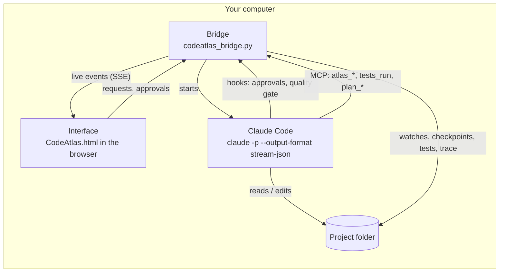

- **Bridge** (Python, one file, standard library only): starts Claude Code in the project folder, reads its event stream, watches files, creates checkpoints, runs builds, programs and tests, and serves the interface.
- **Interface** (React, one file): analyses the code in the browser, draws the diagram on a canvas and connects to the bridge via an event stream.
- **Claude Code** runs unchanged – with your account, your settings, your model. The atlas hooks in through official means: `stream-json` output, hooks and an MCP server.

Prefer working with Claude Code in the terminal or in VS Code? Turn on ⚙ → *AI* → **Follow Claude Code in the terminal** – the same live view then appears in the atlas.

## Security

- The bridge listens on `127.0.0.1` only and requires a token with every request.
- The browser cannot start arbitrary commands – only the presets defined at start-up.
- The AI's shell commands only run after your approval; without an answer they are declined after 5 minutes.
- A checkpoint is created before every request.
- Code written by the AI runs with your permissions when you run or test it – look at it before starting an unknown program.

## Supported languages

**Diagram:** C, C++, Python, Java, C#, JavaScript, TypeScript, Go, Rust, Kotlin, Swift, PHP, Dart, Structured Text (IEC 61131-3), SQL and, simplified, many more.
**Running with live tracing and tests:** C/C++ and Python. Build checks additionally for TypeScript, C#, Go and Rust.

## Building the interface yourself

`CodeAtlas.html` is a bundle of `src/CodeAtlasLab.jsx` and React. After changing the JSX:

```bash
cd build
npm install
npm run build     # writes ../CodeAtlas.html
npm run dev       # development build with readable error messages
```

The interface is written in German; English comes from a translation layer (`I18N_EN` in `src/CodeAtlasLab.jsx`) that translates everything visible – text, tooltips, diagram labels. New texts need an entry there.

## Project structure

```
Code-Atlas/
├── codeatlas_bridge.py      bridge: Claude Code, files, build, running, tests, MCP
├── CodeAtlas.html           prebuilt interface (served by the bridge)
├── CodeAtlas-starten.bat    launcher for Windows
├── README.de.md             README in German
├── src/CodeAtlasLab.jsx     interface source
├── build/                   esbuild script for bundling
├── examples/torsteuerung/   small C example project
└── docs/
    ├── DOCUMENTATION.md     full documentation (usage, storage locations, HTTP interface)
    ├── DOKUMENTATION.md     the same in German
    └── images/              pictures for the READMEs
```

The atlas creates a `.codeatlas/` folder in your project (history, checkpoints, pipeline, rules, test mapping). Add it to your project's `.gitignore`.

## Status and limitations

- Developed and tested on Linux. Windows (the main target) and macOS are intended but not fully tested yet.
- The automated tests use a simulated Claude Code CLI that produces the same events, hooks and MCP calls as the real one. How often the real model uses the atlas tools on its own depends on the model and the request.
- The code analysis is heuristic (not a full compiler parser) – with unusual code a connection may be missing or appear where there is none.
- Code comments and identifiers are in German.

More on all features, storage locations and the bridge's HTTP interface: **[docs/DOCUMENTATION.md](docs/DOCUMENTATION.md)**.

## License

[MIT](LICENSE)
